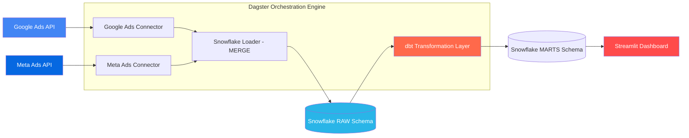

# 📊 Ad Performance Dashboard

A production-style data engineering pipeline and interactive dashboard that extracts, loads, transforms, orchestrates, and visualizes campaign performance data from **Meta (Facebook) Ads** and **Google Ads**.


---

## 📌 Note on API Access & Constraints

This project contains fully functional, production-grade API connectors for both **Meta Marketing API** and **Google Ads API (GAQL)**. However, due to external API platform requirements:

* **Meta Marketing API:** Connects and authenticates live via OAuth. Because the personal ad account has no active ad spend history, the live API returns 0 records.
* **Google Ads API:** Restricted to the **Test Account** tier, which is a sandbox for UI navigation rather than programmatic data retrieval. Production access (**Basic Access**) requires a verified business domain, which is impractical for a personal portfolio project.

To ensure the Streamlit dashboard and data pipeline demonstrate rich, realistic analytical workloads, the pipeline runs using a **seeded mock data generator** covering 7 campaigns across 30 consecutive days. All connectors remain active in the codebase to demonstrate real-world integration architecture.

---

## 🏗️ Architecture



### Data Flow

1. **Extract (Python)** — Custom connectors extract campaign-level metrics (`spend`, `clicks`, `impressions`, `conversions`, `revenue`) from Google Ads and Meta Ads APIs.
2. **Load (Snowflake)** — The `SnowflakeLoader` uses RSA key-pair authentication and executes SQL `MERGE` (upsert) statements on `(campaign_id, date)` to prevent duplicate records on pipeline reruns.
3. **Transform (dbt)** — A 3-layer dbt project processes raw data into analytics-ready models:
   * **Staging:** `stg_google_ads`, `stg_meta_ads` (standardize schemas, trim strings, handle nulls)
   * **Intermediate:** `int_campaigns_unioned` (union platform datasets)
   * **Marts:** `dim_campaign`, `fct_campaign_performance`, `fct_daily_platform_summary` (compute derived metrics: CPC, CTR, cost per conversion, ROAS)
4. **Orchestrate (Dagster)** — Software-Defined Assets (SDAs) manage dependency graphs, retries, and daily cron scheduling (`0 6 * * *`), automatically integrating dbt models via `dagster-dbt`.
5. **Visualize (Streamlit)** — Connects to Snowflake using `snowflake-connector-python` to query final mart tables and render interactive charts and KPI cards.

---

## 📁 Project Structure

```
ad-performance-dashboard/
├── connectors/
│   ├── google_ads.py               # Google Ads API connector + mock data generator
│   └── meta_ads.py                 # Meta Ads API connector + mock data generator
├── loader/
│   └── snowflake_loader.py         # Snowflake loader with MERGE upsert & key-pair auth
├── dbt_project/
│   ├── models/
│   │   ├── staging/               # stg_google_ads, stg_meta_ads, _sources.yml
│   │   ├── intermediate/          # int_campaigns_unioned
│   │   └── marts/                 # dim_campaign, fct_campaign_performance, fct_daily_platform_summary, schema.yml
│   ├── macros/
│   │   └── generate_schema_name.sql # Custom schema routing (STAGING, INTERMEDIATE, MARTS)
│   ├── dbt_project.yml
│   └── profiles.yml               # Snowflake connection profile (gitignored credentials)
├── dagster_project/
│   ├── assets.py                  # Software-defined assets (extract -> load -> dbt)
│   ├── definitions.py             # Dagster workspace entrypoint
│   └── schedules.py              # Daily pipeline schedule definition
├── dashboard/
│   └── app.py                     # Streamlit dashboard querying Snowflake marts
├── config/
│   └── settings.py                # Environment-based dataclasses & logging
├── get_refresh_token.py           # OAuth2 refresh token generator (Google Ads)
├── generate_pdf.py                # Tool documentation PDF generator
├── workspace.yaml                 # Dagster workspace package configuration
├── Dockerfile                     # Multi-purpose container image
├── docker-compose.yml             # Dagster webserver, daemon, and Streamlit services
├── requirements.txt               # Python dependencies
├── .env.example                   # Environment variable template
└── README.md
```

---

## 🚀 Quick Start

### Prerequisites

* Python 3.10+
* Snowflake Trial Account (AWS / Standard edition)

### 1. Clone & Install

```bash
git clone https://github.com/ShariqO/ad-performance-dashboard.git
cd ad-performance-dashboard

python -m venv venv
source venv/bin/activate  # Windows: venv\Scripts\activate

pip install -r requirements.txt
```

### 2. Configure Environment & Snowflake Key-Pair

Generate an RSA key pair for Snowflake authentication:

```bash
mkdir -p credentials
openssl genrsa 2048 | openssl pkcs8 -topk8 -inform PEM -out credentials/snowflake_key.p8 -nocrypt
openssl rsa -in credentials/snowflake_key.p8 -pubout -out credentials/snowflake_key.pub
```

Attach the public key to your Snowflake user in Snowsight:

```sql
ALTER USER YOUR_USERNAME SET RSA_PUBLIC_KEY='<contents of credentials/snowflake_key.pub without header/footer>';
```

Copy `.env.example` to `.env` and set your credentials:

```bash
cp .env.example .env
```

### 3. Materialize Dagster Asset Graph & Run dbt Models

```bash
# Execute end-to-end Dagster pipeline materialization
python -c "from dagster import materialize; from dagster_project.definitions import defs; materialize(assets=defs.assets, resources=defs.resources)"
```

### 4. Launch Dagster UI & Streamlit Dashboard

```bash
# Launch Dagster UI (Asset graph, runs, schedules)
dagster dev -w workspace.yaml
# Access at http://localhost:3000

# In a separate terminal, launch Streamlit Dashboard
streamlit run dashboard/app.py
# Access at http://localhost:8501
```

---

## 💎 dbt Transformation Layer Details

The dbt project transforms raw data through **6 models** with **16 automated data quality tests**:

| Layer | Model Name | Materialization | Description |
| :--- | :--- | :--- | :--- |
| **Staging** | `stg_google_ads` | View | Cleans Google Ads raw metrics, trims strings, handles null values |
| **Staging** | `stg_meta_ads` | View | Cleans Meta Ads raw metrics, trims strings, handles null values |
| **Intermediate** | `int_campaigns_unioned` | View | Unions cleaned Google and Meta data into a single schema |
| **Marts** | `dim_campaign` | Table | Dimension table: campaign metadata, first/last seen dates, active days |
| **Marts** | `fct_campaign_performance` | Table | Fact table: daily performance with derived metrics (`CPC`, `CTR`, `Cost per Conversion`, `ROAS`) |
| **Marts** | `fct_daily_platform_summary` | Table | Fact table: platform-level daily summaries and weighted average performance |

### Data Quality & Testing (16 Tests Total)

Run tests using dbt:

```bash
cd dbt_project
dbt test --profiles-dir .
```

* **Primary Key Uniqueness & Non-Null:** Verified on `dim_campaign.campaign_id` and composite keys.
* **Platform Categorization:** `accepted_values` test enforcing `['google', 'meta']` on `int_campaigns_unioned.platform`.
* **Foreign Key Referential Integrity:** `relationships` test asserting all `fct_campaign_performance.campaign_id` records exist in `dim_campaign`.
* **Column Completeness:** `not_null` assertions across all date, spend, and metric fields.

---

## 🐳 Running with Docker

```bash
# Start Dagster Webserver (port 3000), Daemon, and Streamlit (port 8501)
docker-compose up --build
```

---

## 💡 Interview Talking Points & Design Rationale

### 1. Why Snowflake MERGE instead of Full Overwrites?
Rather than using `WRITE_TRUNCATE` (full table replace), `SnowflakeLoader` stages incoming extracts into a temporary table and performs a SQL `MERGE` on `(campaign_id, date)`. Existing daily records are updated while new campaign days are inserted, preventing duplicate metrics on pipeline reruns and minimizing warehouse compute costs.

### 2. Why Dagster Software-Defined Assets over Airflow DAGs?
Airflow models workflows as opaque task dependency graphs where data flow between tasks is an afterthought. Dagster treats data assets as first-class objects (Software-Defined Assets). Each step explicitly defines what data asset it produces and consumes, making data lineage, asset-based materialization, and `dagster-dbt` integrations fully transparent in a single unified DAG graph.

### 3. Layered dbt Analytics Engineering Pattern
* **Staging:** Standardizes raw source platform names and formats without altering metric definitions.
* **Intermediate:** Unions disparate sources into a standardized internal model.
* **Marts:** Separates facts and dimensions, pushing complex math (`ROAS = revenue / spend`, `CTR = (clicks / impressions) * 100`) down into SQL database execution for maximum performance.

---

## 🔮 What I'd Add at Scale

- **dbt Cloud / CI Automation:** Automated PR checks executing `dbt build --select state:modified+`.
- **Terraform (IaC):** Declarative provisioning of Snowflake databases, warehouses, roles, and schema grants.
- **Alerting & Monitoring:** Slack / PagerDuty webhooks integrated into Dagster sensor functions for pipeline failure notifications.
- **Streaming Ingestion:** Apache Kafka or Google Cloud Pub/Sub + Snowflake Snowpipe for real-time campaign event streaming.
- **Row-Level Security (RLS):** Snowflake entitlement policies for multi-tenant agency client data isolation.

---

## 📄 License

MIT — feel free to use for educational and portfolio demonstration purposes.
