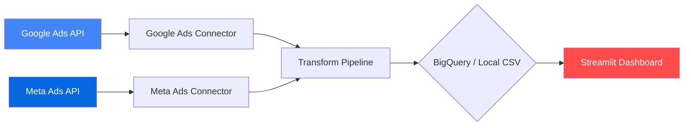

# 📊 Ad Performance Dashboard

A production-style data pipeline and dashboard that aggregates campaign performance data from **Google Ads** and **Meta (Facebook) Ads**, normalizes it into a common schema, computes derived metrics, stores it in **Google BigQuery**, and visualizes everything through an interactive **Streamlit** dashboard.


---

## Architecture



### Data Flow

1. **Extract** — Connectors pull campaign-level metrics (spend, clicks, impressions, conversions, revenue) from each ad platform's API
2. **Transform** — Python calculates derived metrics: CPC, CTR, cost per conversion, ROAS, 7-day moving averages, day-over-day trends
3. **Load** — Data is loaded into a date-partitioned BigQuery table (or local CSV for development)
4. **Visualize** — Streamlit dashboard reads from BigQuery/CSV and renders interactive charts and KPI cards

---

## Project Structure

```
ad-performance-dashboard/
├── connectors/
│   ├── google_ads.py          # Google Ads API connector + mock data generator
│   └── meta_ads.py            # Meta Ads API connector + mock data generator
├── pipeline/
│   ├── bigquery_loader.py     # BigQuery table management + data loading
│   └── transform.py           # Derived metrics & trend calculations
├── dashboard/
│   └── app.py                 # Streamlit dashboard with Plotly charts
├── config/
│   └── settings.py            # Environment-based config with dataclasses
├── run_pipeline.py            # Main ETL orchestrator (CLI entrypoint)
├── get_refresh_token.py       # OAuth2 refresh token generator (Google Ads)
├── Dockerfile                 # Multi-purpose container image
├── docker-compose.yml         # Pipeline + dashboard services
├── requirements.txt           # Python dependencies
├── .env.example               # Environment variable template
└── README.md
```

---

## Quick Start (Mock Mode — No API Keys Needed)

### Prerequisites

- Python 3.10+
- pip

### 1. Clone and install

```bash
git clone https://github.com/ShariqO/ad-performance-dashboard.git
cd ad-performance-dashboard

python -m venv venv
source venv/bin/activate  # Windows: venv\Scripts\activate

pip install -r requirements.txt
```

### 2. Create your `.env` file

```bash
cp .env.example .env
```

The defaults in `.env.example` already set `USE_MOCK_DATA=true` and `LOCAL_MODE=true`, so you can run immediately.

### 3. Run the pipeline

```bash
python run_pipeline.py --mock --local
```

This generates realistic sample data for 4 Google Ads campaigns and 3 Meta Ads campaigns over the last 30 days, runs transformations, and saves the result to `data/ad_performance_data.csv`.

### 4. Launch the dashboard

```bash
streamlit run dashboard/app.py
```

Open [http://localhost:8501](http://localhost:8501) in your browser.

---

## Google Ads API Setup

> Only needed if you want to pull real data. Mock mode works without any of this.

### Step 1: Create a Google Ads Manager Account

1. Go to [ads.google.com/home/tools/manager-accounts](https://ads.google.com/home/tools/manager-accounts/)
2. Create a new Manager (MCC) account — this is free
3. Note your **Manager Account ID** (10-digit number, e.g., `123-456-7890`)

### Step 2: Create a Test Account

Google Ads test accounts require a **dedicated Test Manager Account**, separate from any production manager:

1. Open an **incognito browser window**
2. Sign in with a Google account **not linked** to any existing Google Ads account
3. Create a new Manager Account — it will automatically be a Test Manager (look for the red **"Test Account"** banner)
4. Inside the Test Manager, click **Accounts** → **+** → **Create new account** — sub-accounts automatically inherit test status
5. Note both the **Test Manager ID** and **Test Sub-account ID**

> **Alternative**: Apply for **Basic Access** on your developer token (see Step 3). This lets you query production manager accounts directly, without needing a separate test account.

### Step 3: Apply for API Access

1. Go to **Tools & Settings** → **API Center** in your Manager Account
2. Fill out the application form for a developer token
3. Your token starts with **Test Account** access level — sufficient for test accounts
4. To query production accounts, apply for **Basic Access** (typically approved within 1–2 business days for non-commercial use)
5. Note your **Developer Token**

### Step 4: Create OAuth2 Credentials

1. Go to [console.cloud.google.com](https://console.cloud.google.com/)
2. Create a new project (or use existing)
3. Enable the **Google Ads API**: `APIs & Services` → `Library` → search "Google Ads API"
4. Set up the **OAuth consent screen**: `APIs & Services` → `OAuth consent screen`
   - User type: **External**
   - Add your own email as a **Test user**
5. Create credentials: `APIs & Services` → `Credentials` → `+ CREATE CREDENTIALS` → `OAuth client ID`
   - Application type: **Desktop app**
6. Note the **Client ID** and **Client Secret**

### Step 5: Generate a Refresh Token

A helper script is included for the OAuth2 flow:

```bash
# Ensure your .env has GOOGLE_ADS_CLIENT_ID and GOOGLE_ADS_CLIENT_SECRET set
python get_refresh_token.py
```

This opens a browser window. Sign in with the Google account that has access to your Ads account, authorize the app, and copy the **Refresh Token** that's printed.

### Step 6: Update `.env`

```dotenv
GOOGLE_ADS_DEVELOPER_TOKEN=your_developer_token
GOOGLE_ADS_CLIENT_ID=your_client_id.apps.googleusercontent.com
GOOGLE_ADS_CLIENT_SECRET=your_client_secret
GOOGLE_ADS_REFRESH_TOKEN=your_refresh_token
GOOGLE_ADS_LOGIN_CUSTOMER_ID=1234567890  # No dashes
GOOGLE_ADS_CUSTOMER_ID=9876543210        # No dashes — the test account
USE_MOCK_DATA=false
```

---

## Meta (Facebook) Ads API Setup

> Only needed if you want to pull real data. Mock mode works without any of this.

### Step 1: Create a Facebook Developer Account

1. Go to [developers.facebook.com](https://developers.facebook.com/)
2. Click **Get Started** and register as a developer

### Step 2: Create an App

1. Go to [developers.facebook.com/apps](https://developers.facebook.com/apps/)
2. Click **Create App** → Choose **Other** → **Business** type
3. Fill in the app name and contact email
4. Note the **App ID** and **App Secret** (from App Settings → Basic)

### Step 3: Add the Marketing API

1. In your app dashboard, go to **Add Products**
2. Find **Marketing API** and click **Set Up**
3. This enables the `ads_read` and `ads_management` permissions

### Step 4: Generate an Access Token

1. Go to [developers.facebook.com/tools/explorer](https://developers.facebook.com/tools/explorer/)
2. Select your app from the dropdown
3. Click **Generate Access Token**
4. Grant the required permissions: `ads_read`, `ads_management`
5. Copy the token — this is a **short-lived token** (~1 hour)

**Exchange for a long-lived token** (~60 days):

```bash
curl -s "https://graph.facebook.com/v19.0/oauth/access_token?\
grant_type=fb_exchange_token&\
client_id=YOUR_APP_ID&\
client_secret=YOUR_APP_SECRET&\
fb_exchange_token=YOUR_SHORT_LIVED_TOKEN" | python -m json.tool
```

### Step 5: Find Your Ad Account ID

1. Go to [business.facebook.com](https://business.facebook.com/)
2. Navigate to **Business Settings** → **Accounts** → **Ad Accounts**
3. Your account ID is in the format `act_XXXXXXXXXX`

> **Note:** Meta does not offer a true "test ad account" with pre-populated data. If you don't have a real ad account with campaigns, the mock data generator is the recommended approach for development and demos.

### Step 6: Update `.env`

```dotenv
META_APP_ID=your_app_id
META_APP_SECRET=your_app_secret
META_ACCESS_TOKEN=your_long_lived_access_token
META_AD_ACCOUNT_ID=act_your_ad_account_id
```

---

## BigQuery Setup

> Only needed if `LOCAL_MODE=false`. Skip this for local development.

### Step 1: GCP Project

1. Go to [console.cloud.google.com](https://console.cloud.google.com/)
2. Create a new project or select an existing one
3. Enable the **BigQuery API**: `APIs & Services` → `Library` → search "BigQuery API"

### Step 2: Service Account

1. Go to `IAM & Admin` → `Service Accounts` → `+ CREATE SERVICE ACCOUNT`
2. Name: `ad-dashboard-sa`
3. Roles: **BigQuery Data Editor** + **BigQuery Job User**
4. Click **Create**, then go to the **Keys** tab → **Add Key** → **Create new key** → **JSON**
5. Save the JSON file as `credentials/service-account.json` in the project root

### Step 3: Update `.env`

```dotenv
GCP_PROJECT_ID=your-gcp-project-id
BQ_DATASET=ad_performance
BQ_TABLE=ad_metrics
GOOGLE_APPLICATION_CREDENTIALS=credentials/service-account.json
LOCAL_MODE=false
```

### BigQuery Schema

The pipeline creates a date-partitioned `ad_metrics` table:

| Column | Type | Description |
|--------|------|-------------|
| `date` | DATE | Metric date |
| `platform` | STRING | `google` or `meta` |
| `campaign_id` | STRING | Platform-specific ID |
| `campaign_name` | STRING | Campaign name |
| `impressions` | INTEGER | Total impressions |
| `clicks` | INTEGER | Total clicks |
| `spend` | FLOAT | Spend in USD |
| `conversions` | FLOAT | Conversion count |
| `revenue` | FLOAT | Revenue in USD |
| `cost_per_click` | FLOAT | spend / clicks |
| `click_through_rate` | FLOAT | (clicks / impressions) × 100 |
| `cost_per_conversion` | FLOAT | spend / conversions |
| `roas` | FLOAT | revenue / spend |
| `updated_at` | TIMESTAMP | Pipeline run timestamp |

---

## Running with Docker

### Build and run

```bash
# Start both pipeline and dashboard
docker-compose up --build

# Run pipeline only
docker-compose run pipeline

# Dashboard only (after pipeline has run)
docker-compose up dashboard
```

### Environment

Docker Compose reads from your `.env` file automatically. For BigQuery, mount your service account key:

```bash
mkdir -p credentials
cp /path/to/your/service-account.json credentials/
```

---

## Scheduling Daily Runs

### Option A: Local cron (macOS/Linux)

```bash
# Edit crontab
crontab -e

# Run pipeline daily at 6 AM
0 6 * * * cd /path/to/ad-performance-dashboard && /path/to/venv/bin/python run_pipeline.py >> logs/pipeline.log 2>&1
```

### Option B: Google Cloud Scheduler + Cloud Run

1. Containerize with `docker build -t gcr.io/PROJECT_ID/ad-pipeline .`
2. Push: `docker push gcr.io/PROJECT_ID/ad-pipeline`
3. Deploy to Cloud Run:
   ```bash
   gcloud run deploy ad-pipeline \
     --image gcr.io/PROJECT_ID/ad-pipeline \
     --command "python" \
     --args "run_pipeline.py" \
     --set-env-vars "USE_MOCK_DATA=false,LOCAL_MODE=false" \
     --no-allow-unauthenticated
   ```
4. Create a Cloud Scheduler job:
   ```bash
   gcloud scheduler jobs create http ad-pipeline-daily \
     --schedule "0 6 * * *" \
     --uri "https://ad-pipeline-XXXXX.run.app" \
     --http-method POST \
     --oidc-service-account-email ad-dashboard-sa@PROJECT_ID.iam.gserviceaccount.com
   ```

---

## CLI Reference

```
usage: run_pipeline.py [-h] [--mock] [--mock-google] [--mock-meta] [--local] [--days DAYS]

options:
  --mock          Use mock data for all connectors
  --mock-google   Use mock data for Google Ads only
  --mock-meta     Use mock data for Meta Ads only
  --local         Save to local CSV instead of BigQuery
  --days DAYS     Number of days to look back (default: 30)
```

### Common Usage Patterns

```bash
# Full mock mode — no API keys needed, saves to local CSV
python run_pipeline.py --mock --local

# Real Google Ads + mock Meta → BigQuery
python run_pipeline.py --mock-meta

# Mock Google + real Meta Ads → BigQuery
python run_pipeline.py --mock-google

# Everything real → BigQuery
python run_pipeline.py

# Custom lookback period
python run_pipeline.py --mock --local --days 7
```

---

## Dashboard Features

| Feature | Description |
|---------|-------------|
| **KPI Cards** | Total spend, clicks, CTR, CPC, conversions, ROAS with period-over-period deltas |
| **Spend Trends** | Daily spend by platform (line chart) |
| **CTR Analysis** | Click-through rate trends by platform |
| **CPC Comparison** | Cost per click by campaign (horizontal bar) |
| **Platform Split** | Spend distribution donut chart |
| **Conversions** | Daily conversion volume by platform (area chart) |
| **ROAS** | Return on ad spend by campaign with break-even line |
| **Campaign Table** | Sortable, formatted table with all metrics |
| **Filters** | Date range, platform, campaign name |

---

## Interview Talking Points

### Architecture Decisions

- **Normalized schema**: Both platforms map to a single table, making cross-platform analysis trivial. In production, I'd keep raw tables per platform and use dbt for the transformation layer.
- **Date partitioning**: BigQuery partitions by date to minimize query costs — only scans the date ranges you filter on.
- **WRITE_TRUNCATE**: Each pipeline run replaces data to avoid duplicates and keep within free-tier storage. At scale, I'd use WRITE_APPEND with deduplication logic.
- **Mock data generators**: Both connectors include seeded random data generators, enabling end-to-end pipeline testing and demo without live API credentials.
- **Dual-mode loading**: The `LOCAL_MODE` flag allows rapid local development with CSV output, then a single env var flip switches to BigQuery — no code changes needed.
- **Safe credential management**: All secrets in `.env` (gitignored), service account JSON in `credentials/` (gitignored), no hardcoded values in source.

### What I'd Add at Scale

- **dbt** for the transformation layer (version-controlled SQL models, data tests)
- **Airflow/Dagster** for orchestration instead of a cron job
- **Data quality checks** (Great Expectations or dbt tests) before loading
- **Incremental loads** instead of full refreshes
- **Error alerting** (Slack/PagerDuty integration)
- **CI/CD** with GitHub Actions for testing and deployment
- **Terraform** for infrastructure-as-code (BigQuery datasets, Cloud Run, Scheduler)
- **Row-level security** in BigQuery for multi-tenant access
- **Streaming ingestion** via Pub/Sub for real-time dashboards

### Technologies

- **Python** — ETL scripting, API integrations
- **Google Ads API** (GAQL) — campaign performance queries
- **Meta Marketing API** — insights endpoint with action breakdowns
- **BigQuery** — columnar data warehouse, SQL analytics
- **Streamlit** — rapid dashboard prototyping
- **Plotly** — interactive, publication-quality charts
- **Docker** — reproducible environments, deployment-ready

---

## License

MIT — use freely for learning and portfolio projects.
